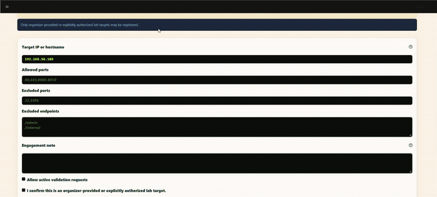
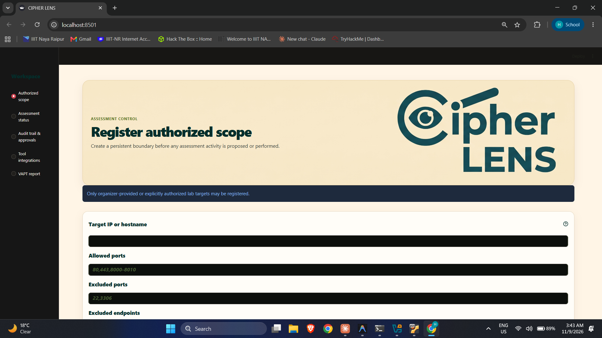
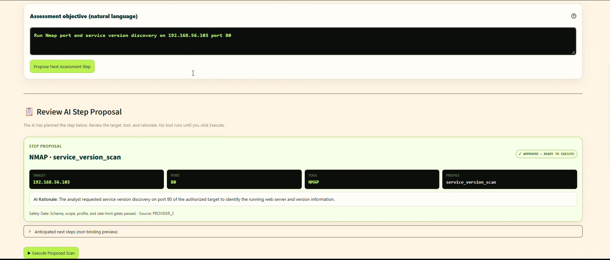
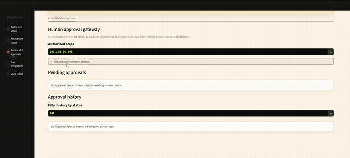

# ◈ CIPHER LENS

### Autonomous, Human-Supervised AI Agent for Authorized VAPT Assessments

[](https://www.python.org/)
[](https://github.com/Harimohan-byte/C1ph3r-L3ns)
[](https://github.com/Harimohan-byte/C1ph3r-L3ns)
[](https://github.com/Harimohan-byte/C1ph3r-L3ns)
[](https://streamlit.io/)

---

## ◈ Overview

**CIPHER LENS** is a local-first, conversational AI agent engineered for authorized Vulnerability Assessment and Penetration Testing (VAPT). Rather than executing a rigid, unthinking scan sequence, Cipher-Lens dynamically analyzes discovered network services and web endpoints to propose adaptive, context-aware assessment steps. 

Every active or intrusive action is strictly governed by a mandatory **human-in-the-loop approval gate**, enforced within registered scope boundaries, and permanently recorded in an immutable cryptographic audit log. The final output is an executive, evidence-backed VAPT PDF report complete with cryptographic SHA-256 artifact verification and a forensic QR integrity seal.

<div align="center">
  
  <p><em>Real-time registration of authorized lab boundaries, attestation verification, and adaptive AI proposal orchestration.</em></p>
</div>

---

## ◈ Key Features

- **Adaptive AI Planning (Not a Static Checklist):**  
  Traditional vulnerability scanners blast pre-configured scripts regardless of whether a service exists. Cipher-Lens's LLM planning engine (with dual Google Gemini slots and deterministic local fallback) inspects previous scanner findings in real time to propose targeted next steps—pivoting dynamically from network port discovery to web server checks, endpoint spidering, and authenticated active validation.
- **Mandatory Human-in-the-Loop Validation Gate:**  
  Autonomous exploitation is strictly forbidden. Active or intrusive validation (such as OWASP ZAP active attacks or payload injection) is blocked by safety policy until an authorized human analyst reviews the target, enters an evidence-linked rationale, and grants an auditable approval token.
- **Unified 5-Tool Intelligence:**  
  Seamlessly combines **3 live scanner adapters** (Nmap, Nikto, OWASP ZAP) with **2 enterprise report import parsers** (Nessus, OpenVAS/Greenbone) into a unified findings database—eliminating tool silos and fragmented spreadsheets.
- **Deterministic Finding Correlation & Prioritization:**  
  Identical vulnerabilities discovered across multiple paths or endpoints are collapsed into consolidated root-cause cards. Findings are enriched with CWE names, OWASP Top 10 categories, and NIST NVD 2.0 CVSS metrics, then ranked using a transparent, deterministic Priority Score (0.0 to 10.0).
- **Immutable Forensic Audit Trail:**  
  Every scope registration, AI proposal gate, scan dispatch, analyst approval decision, and raw evidence SHA-256 hash is permanently recorded in an append-only SQLite audit log.
- **Client-Ready Executive VAPT PDF Report:**  
  Compiles a publication-grade PDF report featuring 4-chip bento executive metrics, finding cards with colored severity bars, prioritized remediation roadmaps (P1–P3), recorded analyst approvals, an **Appendix A** raw artifact evidence register, and an **Appendix B** cryptographic QR integrity seal.

---

## ◈ Tool Integration Matrix

CIPHER LENS maintains a truthful, verified integration status for all supported security tools:

| Tool | Status | Coverage Domain | Declared Mode | Role in Assessment Workflow |
| :--- | :---: | :--- | :--- | :--- |
| **Nmap** | **Live** | Network & Host | CLI Subprocess (Non-shell) | Host discovery, open port enumeration, and service version detection using fixed profile bundles. |
| **Nikto** | **Live** | Web Server | CLI Subprocess (Non-shell) | Web-server misconfigurations, dangerous files, outdated components, and HTTP security headers. |
| **OWASP ZAP** | **Live** | Web App & API | REST API Daemon | Automated endpoint spidering, site-tree discovery, and approved active vulnerability injection scans. |
| **Nessus** | **Import-only** | Infrastructure | Result File Parser | Ingests native `.nessus` XML reports, normalizes enterprise vulnerabilities, and extracts CVEs. |
| **OpenVAS / Greenbone** | **Import-only** | Infrastructure | Result File Parser | Ingests OpenVAS/Greenbone GMP XML reports, correlates CVEs, and unifies findings into the audit ledger. |

> **Graceful Degradation:** If Nmap, Nikto, or ZAP are not locally installed on the host machine, CIPHER LENS detects this at startup and automatically operates in Import-only mode without crashing or raising unhandled exceptions.

---

## ◈ How It Works

```
┌────────────────────────────────────────────────────────────────────────────────────────┐
│                                  CIPHER LENS WORKFLOW                                  │
│                                                                                        │
│  [1. Scope Boundary]   Target IP/Hostname + Port Range + Ethical Lab Attestation       │
│           │                                                                            │
│  [2. AI Proposal]      LLM Analyzes Findings -> Proposes Next Step + Profile           │
│           │                                                                            │
│  [3. Policy Gate]      Recon: Auto-Approved  |  Active Attack: Awaiting Approval       │
│           │                                                                            │
│  [4. Human Approval]   Security Officer Grants 15-Minute Token + Justification         │
│           │                                                                            │
│  [5. Tool Execution]   Nmap / Nikto / ZAP / Nessus / OpenVAS -> Raw Artifact Hashed    │
│           │                                                                            │
│  [6. Normalization]    Deduplicate Endpoints -> Map CWE/OWASP -> Score Priority        │
│           │                                                                            │
│  [7. VAPT Report]      Deterministic Client-Ready PDF + Forensic QR Integrity Seal     │
└────────────────────────────────────────────────────────────────────────────────────────┘
```

### Step 1: Scope Registration & Ethical Attestation
Register target boundaries, allowed ports, and permitted action classes. Any scan target or port outside this boundary is rejected before execution.

<div align="center">
  
</div>

### Step 2: Adaptive AI Step Proposal & Safety Gating
The analyst specifies an objective or requests a proposal. The AI evaluates current findings and proposes an exact tool, profile, target, and port. Passive reconnaissance steps are approved automatically; active validation steps are gated.

<div align="center">
  
</div>

### Step 3: Human-in-the-Loop Approval Gateway
Active validation requests (such as ZAP active scans) remain blocked until an authorized analyst inspects the request, enters their identity and justification, and grants an approval token valid for 15 minutes.

<div align="center">
  
</div>

### Step 4: Evidence Ingestion & Cryptographic Verification
Scanners run in non-shell subprocesses or REST API sessions. Raw outputs (XML, JSON) are hashed with SHA-256 prior to persistence, ensuring an unalterable chain of custody.

### Step 5: Correlation, Enrichment & Prioritization
Findings across tools and endpoints are consolidated into single root causes, enriched with CWE definitions and OWASP Top 10 categories, and scored using a deterministic formula (0.0 to 10.0).

### Step 6: One-Click VAPT PDF Report Generation
Generate an executive, client-ready PDF report featuring executive metrics, prioritized remediation roadmaps, recorded human approvals, and an immutable evidence register.

---

## ◈ Getting Started

### Prerequisites

- **Python:** Python 3.11, 3.12, or 3.13 (`python --version`)
- **Git:** For cloning and version control
- **Security Scanners (for live scanning mode):**
  - **Linux (Debian/Ubuntu/Kali):**
    ```bash
    sudo apt-get update && sudo apt-get install -y nmap nikto zaproxy
    ```
  - **macOS (Homebrew):**
    ```bash
    brew install nmap nikto owasp-zap
    ```
  - **Windows (Chocolatey):**
    ```powershell
    choco install nmap nikto
    ```
- **OWASP ZAP Daemon:**  
  Start ZAP in headless daemon mode:
  ```bash
  ./zap.sh -daemon -host 0.0.0.0 -port 8080 -config api.disablekey=true -config api.addrs.addr.name=".*" -config api.addrs.addr.regex=true
  ```

---

### Installation

1. **Clone the repository:**
   ```bash
   git clone https://github.com/Harimohan-byte/C1ph3r-L3ns.git
   cd C1ph3r-L3ns
   ```

2. **Create and activate an isolated virtual environment:**
   ```bash
   # Linux / macOS:
   python3 -m venv .venv
   source .venv/bin/activate

   # Windows (PowerShell):
   python -m venv .venv
   .\.venv\Scripts\Activate.ps1
   ```

3. **Install dependencies:**
   ```bash
   pip install --upgrade pip
   pip install -r requirements.txt
   ```

---

### Environment Configuration

Copy the example environment file:

```bash
# Linux / macOS:
cp .env.example .env

# Windows (PowerShell):
Copy-Item .env.example .env
```

Open `.env` in your text editor and configure your variables:

| Variable | Description | Default / Example |
| :--- | :--- | :--- |
| `CIPHER_LENS_DATA_DIR` | Local directory for SQLite database, evidence XML/JSON, and reports. | `./data` |
| `PROVIDER_1_BASE_URL` | OpenAI-compatible endpoint for primary LLM. | `https://generativelanguage.googleapis.com/v1beta/openai` |
| `PROVIDER_1_API_KEY` | Primary API key (e.g. Google Gemini API key). | *(your API key)* |
| `PROVIDER_1_MODEL` | Primary model identifier. | `gemini-2.0-flash-lite` |
| `PROVIDER_2_BASE_URL` | OpenAI-compatible endpoint for secondary/fallback LLM. | `https://generativelanguage.googleapis.com/v1beta/openai` |
| `PROVIDER_2_API_KEY` | Secondary API key for automatic failover resilience. | *(your API key)* |
| `PROVIDER_2_MODEL` | Secondary model identifier. | `gemini-2.0-flash` |
| `ZAP_BASE_URL` | Local REST daemon URL for OWASP ZAP. | `http://127.0.0.1:8080` |
| `NVD_API_KEY` | Optional NIST NVD 2.0 API key for automated CVE lookup. | *(leave blank for zero-cost operation)* |

> **Zero-Cost & Offline Operation:**  
> If no API keys are provided in `.env`, Cipher-Lens automatically falls back to its internal, deterministic rule-based planning engine. Scanner findings extract native CVE/CWE data without any external API calls.

---

### Running the Application

Launch the Streamlit web interface:

```bash
streamlit run src/cipher_lens/app.py
```

Open your browser at **`http://localhost:8501`**.

---

### Running the Test Suite

Execute the automated test suite (109 unit and integration tests):

```bash
pytest
```

Expected output:
```text
============================ 109 passed in ~16s =============================
```

---

## ◈ Safety & Authorization Notice

> [!IMPORTANT]
> **LEGAL & ETHICAL NOTICE**
> 
> **CIPHER LENS is designed strictly for authorized security assessments, academic research, and defensive auditing against targets you explicitly own or have written permission to test.**
> 
> The platform enforces security safety controls at the architectural level:
> 1. **Boundary Enforcement:** All network scans are validated against the attested target and port ranges. Any out-of-scope target is blocked before execution.
> 2. **Zero Autonomous Exploitation:** Active or potentially intrusive tests require explicit human authorization with cryptographic decision logging.
> 3. **Immutable Audit Ledger:** Every action, decision rationale, and scanner execution is permanently recorded.

---

## ◈ Repository Structure

```text
CIPHER_LENS/
├── assets/                    # Screenshots, GIFs, and brand assets for documentation
├── src/
│   └── cipher_lens/
│       ├── adapters/          # Tool adapters: Nmap, Nikto, ZAP, Nessus, OpenVAS
│       ├── domain/            # Data models: findings, proposals, scopes, validation
│       ├── persistence/       # SQLite repositories and append-only audit ledger
│       ├── services/          # Planning engine, approval workflow, NVD, reporting
│       ├── ui/                # Streamlit workspaces (Scope, Audit, Report, Assessment)
│       ├── app.py             # Main Streamlit application entry point
│       └── config.py          # Environment settings, provider slots, local paths
├── tests/
│   ├── integration/           # End-to-end assessment-to-report lifecycle tests
│   └── unit/                  # Adapter, planning, approval, and report unit tests
├── pyproject.toml             # Pyright and Pytest project configuration
├── requirements.txt           # Verified Python package dependencies
└── README.md                  # Project documentation
```

---

<div align="center">
  <sub>Built with precision for authorized security auditing. ◈ CIPHER LENS</sub>
</div>
